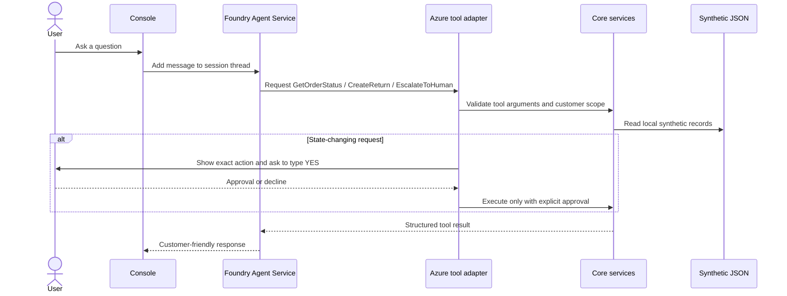

# Day 1 Customer Support Agent

An original, beginner-readable C# console application for a synthetic retail support scenario. It demonstrates multi-turn agent conversations, Azure AI Foundry Agent Service function tools, deterministic local business services, and explicit human approval before state-changing operations.

All included customer and order records are fictional and synthetic.

## Challenge interpretation

The Day 1 challenge asks for a C# Tier-1 agent with instructions, at least two business tools, conversation threads, synthetic data, and escalation. This implementation uses `GetOrderStatus`, `CreateReturn`, and `EscalateToHuman`. It adds ownership checks, idempotent returns, safe tool results, and a console approval gate for both returns and escalations.

The challenge sheet recommends Microsoft Agent Framework packages. At implementation time, the Microsoft Foundry connector was still prerelease, while the Azure SDK reference documented stable `Azure.AI.Agents.Persistent` 1.1.0. To honor the request for stable Azure SDKs, the Azure adapter uses that stable SDK directly. Business services and tests remain independent of the Azure SDK, so the provider adapter can be replaced later.

The implementation was informed by the challenge specification; no source code, documentation, or datasets were copied from the challenge repository. The challenge repository does not grant a reuse license, and this project does not imply its endorsement.

## Architecture



The core project provides the domain records and local services. The console project hosts a replaceable `ICustomerSupportAgent` adapter backed by Foundry Persistent Agents. One Azure thread is kept for the duration of the console session.

## Repository layout

```text
.
├── .github/
│   ├── copilot-instructions.md
│   └── workflows/ci.yml
├── data/
│   ├── customers.json
│   └── orders.json
├── src/
│   ├── Day1Agent.Console/
│   └── Day1Agent.Core/
├── tests/
│   ├── Day1Agent.Core.Tests/
│   └── Day1Agent.Evals/
├── Day1Agent.sln
├── Directory.Build.props
└── Directory.Packages.props
```

## Prerequisites

- .NET 10 SDK (LTS)
- A Microsoft Foundry project and a deployed chat model
- Azure CLI for local authentication (`az login`), or another identity supported by `DefaultAzureCredential`
- The signed-in identity must have permission to use the Foundry project and model deployment

The test suite does not require Azure credentials, an Azure resource, network access, or billable model usage.

## Azure setup

1. Create or select a Microsoft Foundry project.
2. Deploy a supported chat model in that project (the workshop setup uses `gpt-4.1-mini`).
3. Grant the local identity the project role needed to create and use agents (for example, Azure AI User, subject to your organization's RBAC policy).
4. Sign in locally:

   ```powershell
   az login
   ```

5. Set the two required environment variables in the current PowerShell session:

   ```powershell
   $env:AZURE_AI_PROJECT_ENDPOINT = "https://<resource>.services.ai.azure.com/api/projects/<project>"
   $env:AZURE_AI_MODEL_DEPLOYMENT_NAME = "<your-model-deployment-name>"
   ```

The endpoint and deployment name are identifiers, not secrets. Authentication uses `DefaultAzureCredential`; do not put credentials, keys, or connection strings in the repository.

## Restore, build, test, and run

Run these commands from the repository root:

```powershell
dotnet restore
dotnet build --configuration Release
dotnet test --configuration Release
dotnet run --project src/Day1Agent.Console
```

The application validates both environment variables before starting. It then loads the local synthetic data, creates a temporary Foundry agent and thread, and removes them when the session exits normally. The Azure SDK's `PersistentAgentsClient` and `DefaultAzureCredential` do not expose disposable interfaces in the selected stable package; the application therefore disposes the remote agent/thread it creates and does not invent a credential-disposal call.

## Example conversations

Order lookup:

```text
You: Where is order ORD-1001?
[tool] GetOrderStatus
Support: Order ORD-1001 is marked Delivered.
```

Return request (the user must separately type `YES` at the approval prompt):

```text
You: Return item ITEM-1001-A on ORD-1001 because it arrived damaged.
[tool] CreateReturn
Proposed action: Create a return for Trail Lantern (ITEM-1001-A) from order ORD-1001. Reason: it arrived damaged.
Type YES to approve, or anything else to cancel: YES
Support: Your return request was created.
```

Escalation likewise requires the explicit console confirmation. The model cannot supply or simulate the approval value. Enter `exit` to end the conversation; Ctrl+C cancels it.

## Tests and evaluations

`Day1Agent.Core.Tests` verifies known/unknown orders, ownership isolation, valid and unapproved returns, eligibility, idempotency, invalid tool arguments, escalation, and the safety instructions. `Day1Agent.Evals` keeps six conversation prompts as an evaluation fixture and checks that fixture and core instruction constraints deterministically.

The fixture cases marked `requiresLiveAzure` are prompts for an optional manual run against a configured Foundry deployment. Model response quality, tool selection, prompt-injection resistance, and conversational phrasing are nondeterministic and are not claimed as locally proven by fixture-shape tests.

## Security and Responsible AI

- All sample customers and orders are synthetic; no real customer data is included.
- Order access is checked against the current customer ID and returns a generic not-found result for both unknown and inaccessible orders.
- The console identity is fixed to synthetic customer `CUS-1001`. This is a demo boundary, not authentication. A production application must derive customer identity from a trusted authenticated application context, never from model output or a user-editable prompt.
- `CreateReturn` and `EscalateToHuman` do not accept an approval argument from the model. The console displays the proposed action and requires a separate exact `YES` response before invoking the state-changing service.
- Model instructions are defense-in-depth, not an authorization boundary. Keep authorization, validation, and confirmation in application code.
- Prompts are sent to the configured Foundry project and messages are stored in its thread until the application removes that thread. Enter synthetic data only.
- Logs show tool names only. User prompts, tool arguments, customer identifiers, and tool results are not written to application logs.
- External requests are cancellable; Azure failure output avoids stack traces and credential-bearing diagnostics.

## Limitations

- Order data is loaded from local JSON and all service state is in memory; a restart discards return and escalation records.
- The demo has one fixed customer identity, no customer authentication, and no real fulfillment or ticketing integration.
- Confirmation is an interactive terminal step and is not suitable as-is for a web or unattended application.
- The agent uses model-provided instructions and tool selection; live evaluation is needed before any real deployment.
- The Foundry adapter creates a fresh temporary agent for each console session. Abrupt process termination may leave remote resources behind.

## Cost and cleanup

The deterministic unit tests have no Azure cost. Live agent execution incurs the normal model/service charges for the selected Foundry resources. Review your region's current pricing and set a budget alert before experimentation; budget alerts do not stop spending.

On normal exit, the application deletes the thread and temporary agent it created. If the process is terminated abruptly or cleanup fails, inspect the Foundry project and remove only the test resources you can positively identify. Never delete a shared or unrelated Azure resource group.

## Troubleshooting

| Symptom | Check |
| --- | --- |
| Missing configuration message | Set `AZURE_AI_PROJECT_ENDPOINT` and `AZURE_AI_MODEL_DEPLOYMENT_NAME` in the same shell used to run the app. |
| Authentication failed | Run `az login`, confirm the expected tenant, or configure another supported `DefaultAzureCredential` identity. |
| HTTP 401/403 | Confirm the endpoint, project access, model deployment, and role assignment. Allow time for RBAC changes to propagate. |
| HTTP 404 | Confirm the endpoint is the project endpoint and the deployment name matches the deployed model. |
| No model response / timeout | Check Foundry availability and deployment quota, then retry. |
| Tests need Azure | They should not. Run `dotnet test --configuration Release` and check that no live adapter is instantiated by the tests. |

## Attribution

The Day 1 challenge specification is maintained at [AI-Hack](https://github.com/csajmishra/AI-Hack), including the [Day 1 challenge](https://github.com/csajmishra/AI-Hack/blob/main/event-plan/day-1.md), [event overview](https://github.com/csajmishra/AI-Hack/blob/main/event-plan/README.md), and [setup guide](https://github.com/csajmishra/AI-Hack/blob/main/event-plan/setup.md). These links are attribution to the challenge specification only; they do not grant a license to reuse that repository's content or imply endorsement.

This is a new, original implementation released under the MIT License in this repository. All customer and order data included here is synthetic.

## SDK references

- [Azure AI Persistent Agents client library for .NET](https://learn.microsoft.com/dotnet/api/overview/azure/ai.agents.persistent-readme?view=azure-dotnet)
- [PersistentAgentsClient API](https://learn.microsoft.com/dotnet/api/azure.ai.agents.persistent.persistentagentsclient?view=azure-dotnet)
- [Azure Identity for .NET](https://learn.microsoft.com/dotnet/api/overview/azure/identity-readme?view=azure-dotnet)
- [.NET support policy](https://dotnet.microsoft.com/platform/support/policy)
